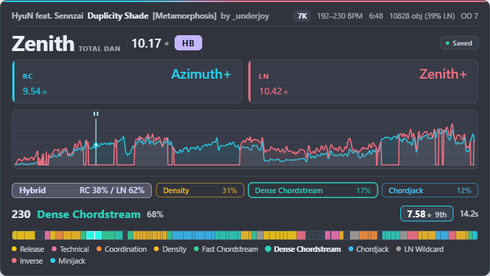
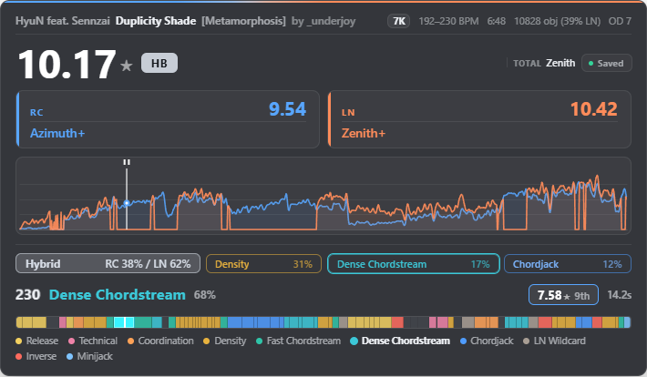
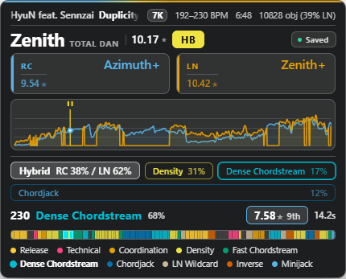
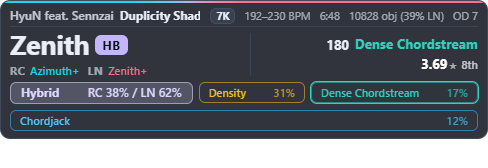

# SPM Map Analyser

A [tosu](https://tosu.app) overlay for **4K, 6K and 7K osu!mania**. See a chart’s difficulty, dan levels and patterns as you play.

[中文](README_zh.md) · [Download v1.2.5](https://github.com/Ist1na07/spm_rating_map_analyser/releases/download/v1.2.5/SPM-Map-Analyser-v1.2.5.zip) · [Release notes](https://github.com/Ist1na07/spm_rating_map_analyser/releases/tag/v1.2.5)

## Install

1. Download **SPM-Map-Analyser-v1.2.5.zip** from the link above, rather than GitHub’s “Source code” archive.
2. Extract it **into tosu’s `static` folder**. The result should be `tosu/static/spm_rating_map_analyser/index.html`, with no extra folder in between.
3. Open the tosu dashboard and select **SPM Map Analyser**.

**Updating?** Replace the files inside your existing overlay folder and refresh the page. Keep its folder name to retain saved settings; tosu stores settings separately for each folder.

## Choose a layout

- **Dan first** (default) leads with the map’s dan and shows its star rating beside it.
- **Rating first** leads with the star rating.
- **Minimal** shows the map’s dans, overall tags and the current segment’s equivalent BPM, pattern and dan. It leaves out stars, the curve and the timeline.
- **Panel Density** offers Standard, Compact and Low profile. Pick **Low profile** if you need a shorter panel that still has the curve and timeline.

**Default Dark · Rating first**

**High Contrast · Dan first, Compact**

**Aurora · Minimal**

## Read the panel

- **Stars and dans:** The panel shows total difficulty plus **RC** (regular notes) and **LN** (holds) where applicable. Compare stars within the same key count and rating model. DT, NC and HT adjust the analysis to the modded speed.
- **Current segment:** The first number, when present, is the pattern’s equivalent BPM, not necessarily the song BPM. Irregular patterns may have no single supported tempo. Full layouts also show confidence, segment difficulty and a colour-coded timeline.
- **Overall tags:** In 7K, percentages describe difficulty-weighted pattern burden and can overlap. The main tag is not always the highest percentage. In 4K/6K, the percentages describe the weighted composition of the map. Hybrid’s displayed RC and LN shares add to 100%.
- **Saved / Cached:** Analysis is saved locally by default. Returning to an unchanged map can reuse it. Turning off **Local Analysis Cache** clears stored results.

## Useful settings

| Setting | Default | When to change it |
|---|---|---|
| Rating Algorithm | Detailed | Choose Compact if you want the lighter model. Stars and dan thresholds differ between models. |
| Sub Difficulty Scheme | Direct | Choose Legacy v0.5.1 to display LN difficulty as the total on LN maps. |
| Dan Display Style | Signs (-/+) | Choose Thirds for low/high labels or Number for decimal dans (8.50 = 8th). |
| Color Scheme | Aurora | Try Default Dark for blue/orange or High Contrast over bright scenes. |
| Curve Smoothing | Medium | Medium matches the previous Light; Strong matches the previous Medium. It only changes the graph. |

The visibility controls can hide the map summary, tags, current segment, segment difficulty or timeline. **Hide While Playing** hides the whole overlay during play.

[Version history](CHANGELOG.md) · [Classifier](CLASSIFIER.md) · [Cache](CACHE.md) · [Testing](TESTING.md) · [MIT license](LICENSE)
