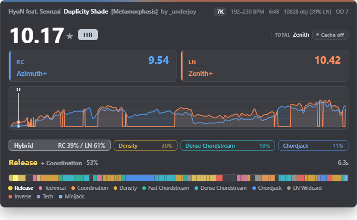
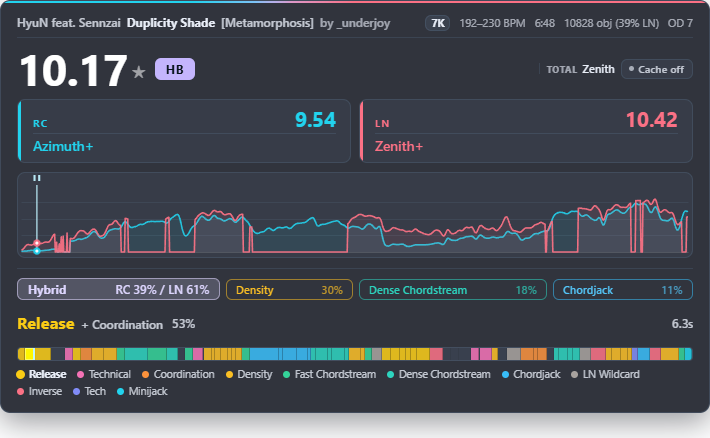
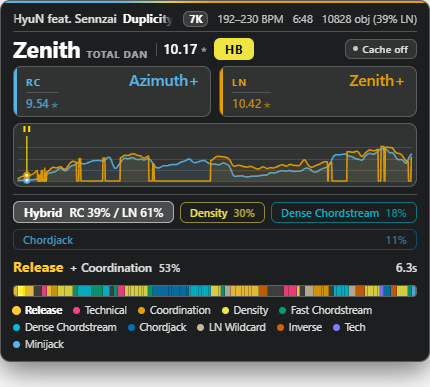
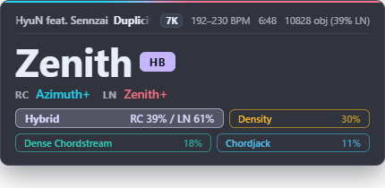

# SPM Map Analyser v1.2.1

一个 [tosu](https://tosu.app) 游戏内叠加界面，为 osu!mania **4K / 6K / 7K** 谱面提供实时难度评级、段位映射与键型分类。

[English](README.md)



## 主要功能

### 难度评级

- 当前谱面的**总难度**（SPM 星数），以及两个子难度：
  - **RC** — 常规（非长键）部分的难度
  - **LN** — 长键（按住）部分的难度
- 纯 RC 谱面会自动隐藏 LN 难度，只显示有意义的数值。
- 评级使用 SPM Rating 的**参考尺度**（每个键数按各自的标注域对齐），因此星数请在同一键数内比较。
- **SPM Rating v1.2.0 的两个模型都已内置**，可在 **Rating Algorithm** 中切换：**SPM Rating v1.2.0-Detailed**（完整模型，默认）与 **SPM Rating v1.2.0-Compact**（上游的轻量模型，差异为 16 个标定参数、角色价格与参考尺度对齐）。切换后会立即重新计算当前谱面。

### 谱面摘要

面板顶部的可选信息行告诉你当前在看什么：**曲师 – 曲名 [难度名]**，以及谱师、键数、BPM（变速谱显示区间）、物量与时长。数值优先取自 tosu 帧，客户端未提供时回落到解析 `.osu` 文件头，因此 stable、lazer 与全部键数下都完整。变速 Mod 会被计入——DT/HT 下 BPM 区间与时长随倍率变化。歌曲行超过面板宽度时会左右滚动显示，不再截断。由 **Show Map Summary** 开关控制。

### 分段难度

游玩时界面跟随你的进度，在当前段键型旁显示该段的**难度**——这一段的 SPM 星数及对应段位。数值由未经平滑的原始分段曲线计算（平滑档位不会影响该数值），因此它永远属于旁边的那个键型标签；鼠标悬停可查看该段峰值与段位。支持 4K／6K／7K。由 **Show Segment Difficulty** 开关控制。

### 难度曲线

- 面板下半部分的难度随时间变化图，带跟随进度的播放游标；游戏暂停时游标变为暂停标记
- 同时含常规与长键段落的谱面会画**两条线**——**RC**（冷色）与 **LN**（暖色），一眼区分流段和长键段；两条线与顶部评级使用同一套校准尺度
- **曲线平滑** 消除原始 400ms 数值的锯齿。强度可从 *Off* 调到 *Max*，单位是绘制的像素而不是秒，因此同一个档位在 30 秒短图和 15 分钟马拉松上看起来一致。峰值会保留：默认档（*Medium*）保留 86% 的原始峰值高度，同时去掉约 90% 的粗糙度（在 332 张 7K 谱面语料上实测）。切换档位不需要重新分析谱面

### 键型分类

插件会自动把谱面切分成若干段落。**7K** 保留细分类：**Chordjack**、**Minijack**、**Chordstream**、**Speed**、**Tech**、**Vibro**、**Coordination**、**Density**、**Inverse**、**Release**、**Technical**、**Break** 与 **Hybrid**。原生 **4K／6K** 使用 **Jack、Chordstream、Speed、Tech、LN** 五类形态，以及 Break 休息段；其中 Chordstream 对应上游兼容字段 `stamina`，不表示泛指耐力的评分。

由此提供：

- **7K 整体标签** — 使用 **SPMTagClassifier 1.2.4 + `b311c40` 提交**的稳定路径，主标签与次要分支旁均显示连续时间多因子积分得到的整谱负担百分数：**分支贴合度 × 难度负担 × 动作物量**。直接复用当前 Detailed／Compact 评分同次生成的原始逐行难度场，不重复评分。它不是识别置信度或时间占比，各键型允许重叠；Hybrid 的 RC／LN 家族份额按原比例归一化显示，合计 100%（仅显示层变更）。切换评分模型会同步更新标签与百分数，曲线平滑不会影响它们
- **4K／6K 整体标签** — 上游主导形态显示为实心标签，其余为轮廓标签。百分数是局部形态支持按**时长 × 相对物理负荷 × 集中度**加权后的归一组成，五类原始份额在取整前合计 100%；与 7K 的难度积分负担不是同一口径。这两种分类器不使用 Detailed／Compact 难度场
- **实时当前段** — 游玩时跟随进度，显示当前段的键型、置信度与等效 BPM
- **键型时间轴** — 覆盖全谱的彩色条带，带播放游标

**分类器来源：** 固定的 [b311c40 源码](https://github.com/Ist1na07/SPMTagClassifier/blob/b311c408ef02d6705d30b51a4ea789d3e86d2976/src/index.cjs) 保留联合重调的 56 维 RC／LN 专家、固定整谱参考先验、逐手假切换排除、LN Wildcard 休息豁免与同类稳定变速分段。它包含已发布 v1.2.4 包之后的未发布修改；`modern` 仍是另一个显式候选。

**持续压力 Break 修补：** 同次 Detailed／Compact 原始难度场现在会在聚合前参与软休息判断，因此切换评分模型也可能改变局部 Break 边界，平滑则不会；长头部空隙及最后头部之后不延拓压力证据，不增加评分次数。详见 [接入约定](CLASSIFIER.md)。

**为什么较低百分比也可能是 7K 主标签？** 实心标签由含先验的门控选出，不是直接对百分数取最大值。Detailed 下，原有标签达到 25% 可保留，新标签通常需要达到 50%，此外还有家族／Mix 门控。因此 Fast Chordstream 33% 可以是实心标签，而 Dense Chordstream 37% 仍是轮廓分支；这些数值表示负担，不是正确率。标签区会使用面板全部宽度，放不下时才换行。

键型分类、当前段难度与时间轴均支持 **4K／6K／7K**。6K 使用上游的共享粗分类模型，不把六列虚拟投影成未经验证的 7K 细类。

### 段位映射

- 评级映射到段位，按键数与技能分别标定：
  - **4K RC**：1st ~ 10th，其后为 **Alpha / Beta / Gamma / Delta / Epsilon** · **4K LN**：1st ~ 15th
  - **6K RC**：Start ~ 9th · **6K LN**：0th ~ 14th
  - **7K RC / LN**：0th ~ Stellium
- 段位节点按**两种 Rating Algorithm 模型分别实测**（SPM Rating v1.2.0-Detailed 与 SPM Rating v1.2.0-Compact），因此切换算法时段位阶梯的含义保持不变
- 超出实测范围时显示 `< ...` / `> ...`（如 `< 0th`、`> Stellium`）
- 段位值支持三种显示风格：**三段**（low / high）、**符号**（`-` / `+`）、**小数数字**（+0.5 偏移：8.5 对应 8dan 整、7K 中 11.5 对应 Gamma）
- 小数模式下，低于 0th 时保留越界标记，显示 **`< 0.50`**，不再显示为 `0.50`
- Hybrid 谱面额外显示 **Total** 段位

### 配色方案与界面风格

**Color Scheme** 提供三套配色：

| 方案 | 说明 |
|------|------|
| **Default Dark** | v1.0.0 的原配色，完全不变 |
| **Aurora** | RC 用青/蓝绿、LN 用珊瑚红——互补色对，在小字号下比蓝/橙更容易区分两个家族——配靛蓝底面板 |
| **High Contrast** | 近黑面板 + 由 Okabe-Ito 派生的色相，为亮色游玩画面上可读而设计 |

三套配色中每一个标签与文字颜色都按 WCAG 4.5:1 对比度实测，并在亮、暗两种游玩画面下分别校验。

**UI Style** 提供两种版式：

| 风格 | 说明 |
|------|------|
| **Rating first** | 星数为头条数字，段位单独一行在下方 |
| **Dan first** | 段位为头条数字（mania 玩家最常引用的指标），星数移到旁边 |
| **Minimal** | 只保留摘要行、段位（总段位带类型徽章、RC、LN）与整体键型标签 |

**Panel Density** 控制面板整体密度：**Compact** 使用更小的字号、更紧的间距与更扁的曲线，占用更少屏幕空间。





### 其他

- **Mod 支持** — 考虑变速 Mod（DT / NC / HT）
- **游玩时隐藏** — 可选在开始游玩后隐藏 overlay

## 使用方法

1. 从本仓库下载 [v1.2.1 源码快照](https://github.com/Ist1na07/spm_rating_map_analyser/archive/refs/heads/main.zip)（本次不发布 Release）；历史打包版本可在 [Releases](https://github.com/Ist1na07/spm_rating_map_analyser/releases) 下载。
2. 将**直接包含 `index.html`、`settings.json`、`metadata.txt` 的那一层文件夹**放入 tosu 的 `static` 目录，不要再套一层解压目录。
3. 启动 tosu，进入 dashboard 即可找到 **SPM Map Analyser** 插件。

### 设置报错或新旧难度相差 0.0几

推荐目录为 `tosu/static/spm_rating_map_analyser_v1.2.1/index.html`。tosu v4.26.3 在嵌套安装时可能无法创建对应的设置文件父目录，报 `ENOENT`。可改为上述单层安装；若保留嵌套结构，例如 `static/外层/内层/index.html`，须先创建 `tosu/settings/外层/`，再打开设置页。不要删除已有 `.values.json` 文件。

插件已修复嵌套路径和 tosu 延迟注入 `COUNTER_PATH` 导致的 `Wrong overlay`；设置读取失败时会在面板顶部显示正在使用默认设置还是保留上次设置，不再静默忽略。鼠标悬停星数可查看当前 Detailed／Compact 模型。更新后刷新已打开的 overlay 页面。

tosu 按安装目录分别存储配置，换目录不会自动沿用旧设置。比较新旧版本时应保持 **Rating Algorithm、Sub Difficulty Scheme 和倍率一致**；否则 Detailed 与 Compact 本来就可能相差 0.01～0.05 等数值。同模型、同谱面和同倍率下，本次优化不改变评分。旧配置可在 tosu 的 `settings/<旧目录>.values.json` 中找到；迁移前备份，只复制到对应新目录的设置文件，不覆盖旧文件。

## 设置

| 设置项 | 说明 | 默认 |
|-------|------|------|
| Rating Algorithm | SPM Rating v1.2.0 的模型选择：**SPM Rating v1.2.0-Detailed**（完整模型）或 **SPM Rating v1.2.0-Compact**（轻量模型）。两者各有独立实测的段位节点，切换后当前谱面会立即重新计算 | Detailed |
| Sub Difficulty Scheme | **Direct**：RC/LN 子难度始终来自新子模型；**Legacy v0.5.1**：LN 谱面的 LN 难度等于总难度 | Direct |
| UI Style | **Rating first**、**Dan first** 或 **Minimal**（只显示摘要、段位与整体键型标签） | Rating first |
| Panel Density | **Standard** 或 **Compact** 面板密度 | Standard |
| Color Scheme | **Default Dark**、**Aurora** 或 **High Contrast** | Default Dark |
| Dan Display Style | 段位值的显示风格：三段（low/high）、符号（-/+）或小数数字（+0.5 偏移：8.5 对应 8dan、11.5 对应 Gamma） | Thirds |
| Curve Smoothing | 难度曲线的平滑强度：Off、Light、Medium、Strong、Max | Medium |
| Hide While Playing | 开始游玩后隐藏 overlay（结算界面会再次显示） | 关 |
| Show Map Summary | 显示曲师/曲名/难度名/谱师/键数/BPM/物量/时长摘要行 | 开 |
| Show Pattern Tags | 显示整体键型标签 | 开 |
| Show Current Segment | 显示当前段键型与等效 BPM | 开 |
| Show Segment Difficulty | 显示当前段的星数与段位（4K／6K／7K） | 开 |
| Show Segment Timeline | 显示全谱键型色带 | 开 |
| Show Break Segments | 休息段显示 "Break" | 开 |

## 版本历史

### v1.2.1
- 跟进分类器 `b311c40`：复用已有原始难度场，在软 Break 门控前保护持续高压力段，不增加评分次数；无难度输入及原生 4K／6K 路径保持不变
- 接入原生 4K／6K 五类标签、加权组成百分数、当前段与时间轴；移除标签区固定 440px 上限，并在提示中解释主标签门控
- 去掉 tag 前的 “Burden” 字样；Hybrid 的 RC／LN 占比保持原比例、归一化至合计 100%，不改算法原始输出及其他 tag 百分数
- 跟进修复：设置 websocket 使用完整且固定的插件相对目录，兼容嵌套／含空格路径与 tosu 延迟注入；增加设置失败提示与当前评分模型 tooltip，避免读取失败后误把默认 Detailed 与旧配置 Compact 作比较
- 完整内置 **SPMTagClassifier `b311c40`**（`b311c408ef02d6705d30b51a4ea789d3e86d2976`，包版本 1.2.4 加未发布局部重调及持续压力 Break 修补）的浏览器引擎，包括已采用的 RC／LN 参数、固定积分先验与分段显示修补
- 整谱标签百分数改为新算法的连续时间多因子积分份额，直接复用当前评分模型的原始难度场，无需重复评分
- 修复数字段位低于 0th 时缺少 `<`，现在显示 `< 0.50`
- 镜像共用恢复曲线、时间窗端点线性扫描、插值算子缓存、动作前缀矩复用：初次接入 v1.2.3 时，本机 371 张谱面的评分平均耗时由 149.5 降至 109.8 ms；同一新版分类器口径的完整流程由 207.7 降至 168.1 ms（缩短 19.1%）。详见 [验证记录](TESTING.md)
- 保留原评分结果、段位表、曲线、已有设置与当前段置信度；不包含本地数据集与谱面

### v1.2.0
- **算法升级到 SPM Rating v1.2.0-rc3 + 全新 SPMSubmodel RC/LN 模型**
- **v1.2.0 的两个模型都可选用**：**Rating Algorithm** 中可选 SPM Rating v1.2.0-Detailed（完整模型）与 SPM Rating v1.2.0-Compact（轻量模型）。两者差异为 16 个标定参数、角色价格与参考尺度对齐；段位节点对两种模型分别重测，切换后当前谱面立即重新计算
- **总难度 / RC 难度 / LN 难度**改用新的手部接触、手指角色、和弦手势与两级聚合模型；每张谱面与其镜像谱一起评分，两份难度场取平均
- **段位映射重测**：按新参考尺度重新标定 4K / 6K / 7K 的 RC / LN 节点，阶梯形状与 `< ...` / `> ...` 越界标记保持不变
- **小数段位显示 +0.5 偏移**：显示的数字即 mania 玩家习惯引用的值，因此 8.5 对应 8dan 整、7K 中 11.5 对应 Gamma。三段、符号显示风格、评级数值、曲线及其他逻辑均不变
- 设置、metadata 与其余谱面分析逻辑保持不变

### v1.0.1
- **新增配色**：**Aurora** 与 **High Contrast**，并对三套配色做了 WCAG 对比度校验（标签文字、次级文字与 Break 文字原本低于 4.5:1，现已全部达标）
- **新增 UI Style**：**Dan first** 把段位提升为主数字；**Minimal** 只显示摘要行、段位（总 / RC / LN，带类型徽章）与整体键型标签
- **新增 Panel Density**：**Compact** 缩小字号、间距与曲线高度
- **谱面摘要行**：曲师/曲名/难度名、谱师、键数、BPM（变速时显示区间）、物量与时长，跟随变速 Mod；超长歌曲行滚动显示而非截断，可开关
- **分段难度**：当前段的星数与段位，显示在键型标签旁，可开关
- **曲线平滑**：像素空间高斯平滑，五档强度，读取谱面后仍可调整；LN 线的结构性零点被精确保留，曲线的横轴与播放游标现在共用同一套时间映射
- **暂停标记**：游戏暂停时播放游标显示暂停符号
- 修复：曲线的 RC 线现在由校准后的 RC 子难度绘制——v1.0.0 在两条线之间混用了原始与校准两种尺度
- 游玩时隐藏状态下不再持续重绘曲线

> 在本次更新的开发过程中，发现spm rating v1.0.0及配套算法存在一些缺陷，将在算法的下个版本尝试修复

### v1.0.0
- **算法升级到 SPM Rating v1.0.0 + 全新 RC/LN 子模型**
- **支持 4K / 6K**：难度评级与段位映射覆盖全部键数
- **段位映射重做**：按键数与技能（RC/LN）分别标定阶梯，实测范围外显示 `< 0th` / `> Stellium`
- **三种段位显示风格**：三段（low/high）、符号（-/+）、小数数字
- **新增设置**：子难度方案（Direct / Legacy v0.5.1）、段位显示风格、游玩时隐藏
- 纯 RC 谱面自动隐藏 LN 难度与 LN 曲线
- 分析速度优化

### v0.5.1
- 性能优化：整图分析（键型分类 + 难度评级）平均耗时 641ms → 188ms；最差的 LN 密集马拉松图 13.6s → 1.2s

### v0.5.0
- 键型分类整体替换为分段键型分类引擎：变化点切分段落、逐段分类、带播放游标的彩色键型时间轴
- 新增实时当前段显示（键型、置信度、等效 BPM）
- 整体标签由段落聚合；Sort 由段落 LN 占比判定
- 非 7K 谱面分类器不再运行，键型 UI 自动隐藏
- 设置项实际生效；界面配色统一（RC 冷蓝、LN 暖橙）

### v0.4.0
- 底层算法升级到 SPM Rating v0.4.0，修正层特征 7 → 9（nps_std、chord2）
- 段位映射重测；LN 掩码校准重拟合；Tag 分类器基于 42 特征重建

### v0.3.0
- 底层算法升级到 SPM Rating v0.3.0（特征修正层）

### v0.2.0
- 底层算法升级到 SPM Rating v0.2.0；Sort/Tag 分类器重新训练

### v0.1.1
- HB 谱面 tag 统一为 Hybrid；新增 Inverse / Technical 分类器；Mix 谱面显示 RC+LN 双难度；修复若干 Bug

### v0.1.0
- 初始发布：Sigmoid 聚合模型 + RC/LN 子模型、键型标签、段位映射、难度曲线、Mod 支持

## 后续可考虑的方向

以下是与 [Leo_Black 的 ManiaMapAnalyser](https://github.com/LeoBlackMT/osumania_map_analyser) 对比后，认为需要真正投入而不只是一个开关的功能，因此只作为记录，v1.0.1 未实现：

- **把每格的 max 换成百分位。** 现在一个 400ms 格子取的是其中最难的那一 note row，于是一个只有单 note 的格子和一个密集格子看起来一样难。取格内 note row 的 85 分位可以从源头消除这个偏置，让曲线天生更稳，不需要任何平滑。
- **封面取色主题。** 从谱面背景图取主色给面板上色，类似 LeoBlack 的 `coverTheme`。需要拉取图片并做颜色量化。
- **版式预设。** LeoBlack 提供 15 套具名预设与 JSON 导入导出。目前两种 UI Style 与两档密度已覆盖有用区间；预设系统要有更多可预设的内容才划算。
- **更多难度算法。** LeoBlack 通过 WASM/ONNX 集成了 Etterna MinaCalc（五个版本）、Interlude、Sunny Rework、Daniel 与 Companella。那是另一个量级的工程——需要打包二进制、worker 与基准测试框架——而且会改变数字的含义，因此本插件 Rating Algorithm 设置项目前只提供 SPM Rating 自带的两个模型。

## 注意事项

- 难度评级与段位均为估计值，仅供参考。
- 7K 键型分类器基于有限数据训练，小众或罕见键型可能偶有误判。
- 旧版 osu!stable 谱面（v12 及以下格式）可能无法解析。

## 开发

在包含 Git 历史的源码 checkout 中使用 Node 20 或更新版本运行：

```sh
node --test tests/regression.test.cjs
# 可选：读取本地数据集／谱面及固定到 `b311c40` 的分类器运行源码。
node tests/corpus.cjs ../dataset ../maps ../SPMTagClassifier
```

浏览器验收脚本为 `tests/browser.cjs`，测试依赖与运行方法见 [TESTING.md](TESTING.md)。

测试逐值对比原 `1e99e4d` 引擎的评分，并覆盖原始难度场交接、双模型、倍率、时间窗边界与段位标签。可选语料检查另验证浏览器 bundle 与上游原件一致、Node／浏览器输出一致；JSON 报告仅输出到标准输出，不复制谱面到仓库。[TESTING.md](TESTING.md) 记录本次实际验收，[CLASSIFIER.md](CLASSIFIER.md) 记录固定的上游版本。

## 参考

- [tosu](https://tosu.app) — 本 overlay 的运行环境
- [SPM Rating](https://github.com/Ist1na07/SPMRating) — 难度算法
- [SPMTagClassifier b311c40](https://github.com/Ist1na07/SPMTagClassifier/tree/b311c408ef02d6705d30b51a4ea789d3e86d2976) — 键型分类与整谱负担积分
- [SPM Submodel](https://github.com/Ist1na07/SPMSubmodel) — RC / 长键子模型

## License

MIT — 详见 [LICENSE](LICENSE)
