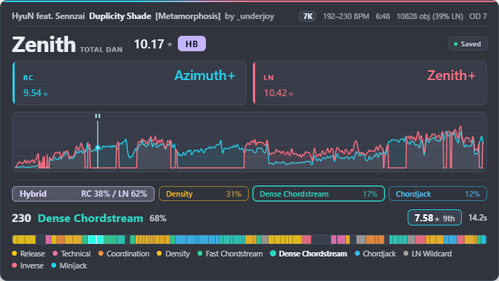
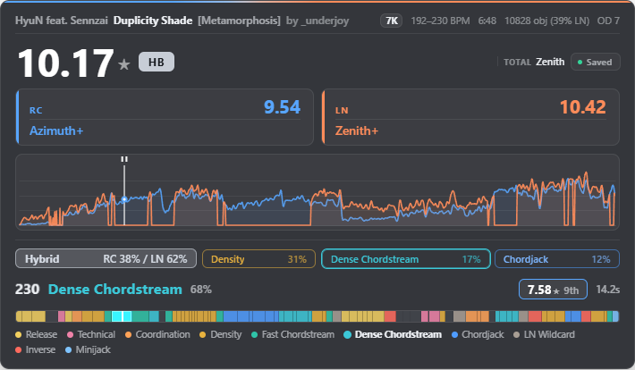
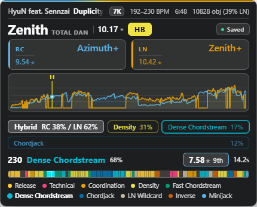
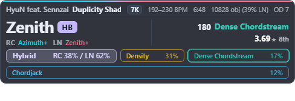

# SPM Map Analyser

为 [tosu](https://tosu.app) 提供的 osu!mania 叠加面板，支持 **4K、6K、7K**。选谱或游玩时查看难度、段位和键型。

[English](README.md) · [下载 v1.2.5](https://github.com/Ist1na07/spm_rating_map_analyser/releases/download/v1.2.5/SPM-Map-Analyser-v1.2.5.zip) · [发布说明](https://github.com/Ist1na07/spm_rating_map_analyser/releases/tag/v1.2.5)

## 安装

1. 从上方链接下载 **SPM-Map-Analyser-v1.2.5.zip**，不要选 GitHub 的「Source code」。
2. **直接解压到 tosu 的 `static` 目录**。解压后路径应为 `tosu/static/spm_rating_map_analyser/index.html`，中间不要再套一层。
3. 打开 tosu 控制台，选择 **SPM Map Analyser**。

**从旧版升级？** 用压缩包里的文件覆盖原插件文件夹中的同名文件，再刷新面板。保留原文件夹名，tosu 就会沿用该目录对应的已保存设置。

## 选择版式

- **Dan first（默认）**：段位放在首位，星数在旁。
- **Rating first**：星数放在首位。
- **Minimal**：保留谱面段位、整谱标签和当前段的等效 BPM、键型、段位，不显示星数、曲线与时间轴。
- **Panel Density** 提供 Standard、Compact 和 Low profile。想让面板矮一点、又要保留曲线和时间轴，可以选 **Low profile**。

**Default Dark · 星数优先**

**High Contrast · 段位优先，紧凑密度**

**Aurora · 极简**

## 看懂面板

- **星数与段位**：显示总难度，以及适用的 **RC**（常规键）和 **LN**（长键）子难度。比较星数时请使用同一键数和评分模型。DT、NC、HT 按变速后的倍率分析。
- **当前段**：键型前的数字是等效 BPM，不一定等于歌曲 BPM。不规则段落没有可靠的单一速度时，数字留空。完整模式还显示置信度、分段难度和键型时间轴。
- **整谱标签**：7K 百分数表示按难度加权的键型负担，各类可重叠，主标签不一定是百分数最大的。4K／6K 百分数表示谱面的加权键型组成。Hybrid 显示的 RC／LN 占比合计为 100%。
- **Saved／Cached**：默认把结果缓存到本地，再选中未编辑的谱面时可直接复用。关闭 **Local Analysis Cache** 会清除已保存的分析结果。

## 常用设置

| 设置 | 默认值 | 何时调整 |
|---|---|---|
| Rating Algorithm | Detailed | 想用轻量模型时选 Compact。两种模型的星数与段位标定不同。 |
| Sub Difficulty Scheme | Direct | 若希望 LN 谱的 LN 子难度显示为总难度，选 Legacy v0.5.1。 |
| Dan Display Style | Signs (-/+) | 想看 low/high 选 Thirds；想看数字段位选 Number（8.50 = 8th）。 |
| Color Scheme | Aurora | 蓝／橙配色选 Default Dark；背景太亮时可试 High Contrast。 |
| Curve Smoothing | Medium | Medium 等同旧 Light，Strong 等同旧 Medium。只改变曲线，不改变难度。 |

可分别关闭谱面摘要、整谱标签、当前段、分段难度和时间轴。开启 **Hide While Playing** 可在游玩时隐藏整个面板。

[版本历史（英文）](CHANGELOG.md) · [分类器](CLASSIFIER.md) · [缓存](CACHE.md) · [验证记录](TESTING.md) · [MIT 许可](LICENSE)
